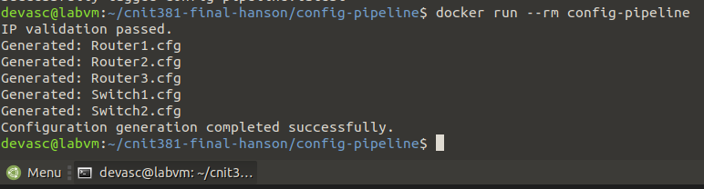
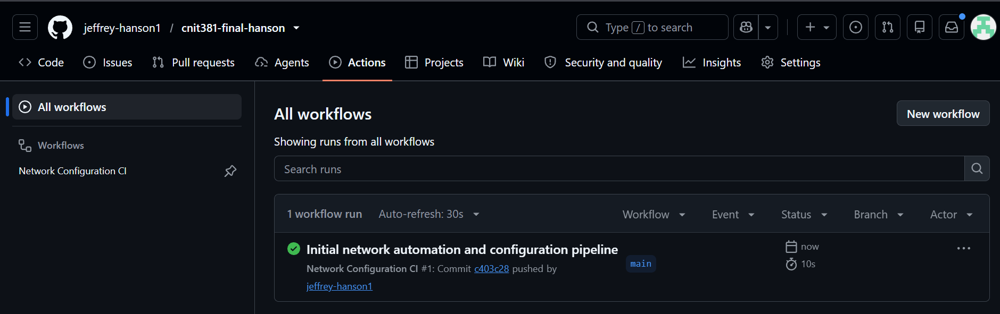
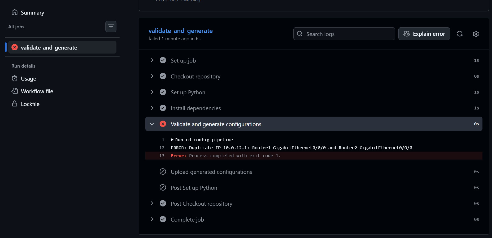
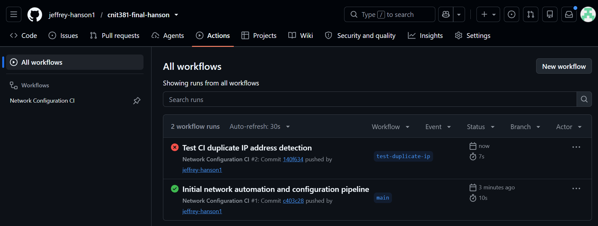
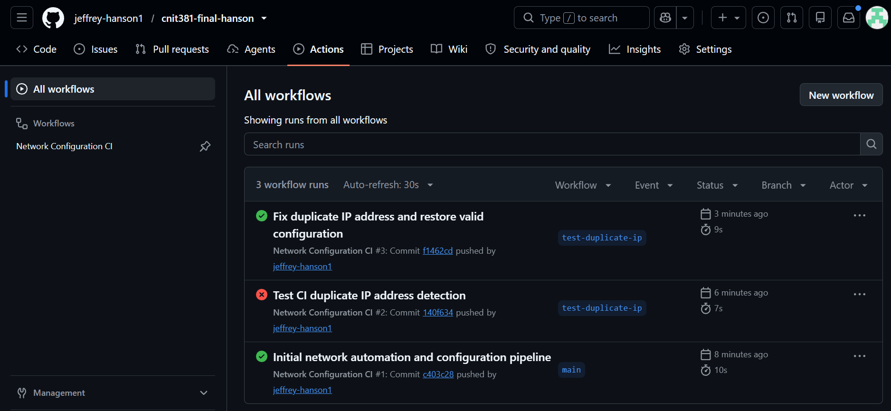
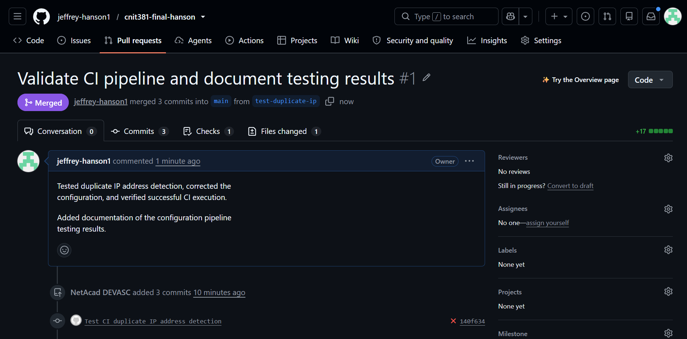

# CNIT 381 Final Project - Testing Results

## Configuration Pipeline Testing

- Docker image build: PASS
- Docker configuration generation: PASS
- Initial GitHub Actions workflow: PASS
- Intentional duplicate IP detection: PASS
- Corrected configuration workflow: PASS
- GitHub branch and pull request: PASS

### 1. Docker Pipeline Success

The Docker image was successfully built and executed to generate network device configurations.

### 2. Initial GitHub Actions Success

The initial GitHub Actions workflow successfully validated the network configuration.

### 3. Intentional Duplicate IP Test

Router2 was intentionally assigned the same IP address as Router1 (10.0.12.1). The pipeline detected the duplicate address and correctly failed the workflow.

### 4. Corrected Configuration

Router2 was restored to its correct IP address of 10.0.12.2. The workflow successfully passed after the correction.

### 5. GitHub Pull Request

The testing branch was successfully merged into the main branch through a pull request.

## Physical Network Testing

Pending testing on physical Cisco equipment.

### Ansible Playbook Verification

- Playbook 01 - Connectivity: Pending
- Playbook 02 - Base Configuration: Pending
- Playbook 03 - EIGRP: Pending
- Playbook 04 - VLANs: Pending
- Playbook 05 - Services: Pending
- Playbook 06 - Configuration Backups: Pending

### Network Verification

- EIGRP neighbors: Pending
- Switch1 VLAN verification: Pending
- Switch2 VLAN verification: Pending
- Inter-switch trunk verification: Pending
- End-to-end ping: Pending

### RESTCONF Verification

- Postman GET: Pending
- Postman PUT (201 Created): Pending
- Loopback1 CLI verification: Pending
- Python RESTCONF GET: Pending
